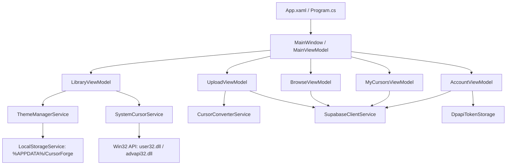
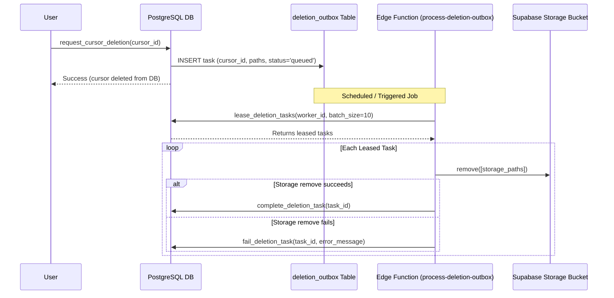

# CursorForge — System Architecture Specification

## 1. Executive Summary

CursorForge is an enterprise-grade Windows desktop application and cloud ecosystem for managing, creating, and sharing Windows mouse cursor schemes. 

This document details the architectural decisions, low-level Win32 contracts, binary cursor encoding specifications, security models, and cloud database designs implemented across the system.

---

## 2. Desktop Client Architecture

### 2.1 Framework & Target Runtime
- **Runtime**: `.NET 10 LTS` (`net10.0-windows10.0.19041.0` / `net10.0-windows`).
- **Target OS**: Windows 10 (Version 1809+, Build 17763) through Windows 11 (24H2+), 64-bit architecture (`win-x64`).
- **UI Framework**: Windows Presentation Foundation (WPF) with `WPF-UI 4.3.0` (lepoco) providing native Windows 11 Fluent Design styles, Mica/Acrylic backdrops, and dark mode theming.
- **MVVM Architecture**: `CommunityToolkit.Mvvm 8.4.2` utilizing compile-time Source Generators (`[ObservableProperty]`, `[RelayCommand]`).
- **Dependency Injection**: `Microsoft.Extensions.DependencyInjection` configured in `App.xaml.cs`.

### 2.2 Component Hierarchy



---

## 3. Windows Cursor Engine Internals

### 3.1 Win32 Subsystem Interaction
Windows manages cursors globally per user session through `user32.dll` and the registry:
- **Registry Schema**: Cursor paths are stored under:
  ```
  HKEY_CURRENT_USER\Control Panel\Cursors
  ```
  Each role corresponds to a registry value name (e.g., `Arrow`, `Hand`, `Wait`, `SizeNWSE`).
- **Named Schemes**: Registered under:
  ```
  HKEY_CURRENT_USER\Control Panel\Cursors\Schemes
  ```
  As comma-separated lists of 15 file paths representing each role in canonical Windows order.
- **Applying Changes Live**:
  Calling `SystemParametersInfo(0x0057 /* SPI_SETCURSORS */, 0, IntPtr.Zero, 0x01 /* SPIF_UPDATEINIFILE */ | 0x02 /* SPIF_SENDCHANGE */)` commands Windows to reload cursor files from the registry and broadcast `WM_SETTINGCHANGE` to all top-level windows.

### 3.2 Registry Snapshot & Crash Safety
To prevent irreversible desktop corruption:
1. **Pre-modification Snapshot**: CursorForge serializes the current registry state into `%APPDATA%\CursorForge\original_cursors.json`.
   - Records key existence (`IsPresent: bool`).
   - Records registry value type (`REG_SZ` vs `REG_EXPAND_SZ`).
   - Records raw string data.
2. **Crash Recovery Marker**:
   - Before writing new values to registry, a `pending_apply.json` file is written atomically.
   - If an unexpected system crash or power outage occurs during the registry write, CursorForge detects `pending_apply.json` at next launch and automatically triggers `RollbackToSnapshot()`.
   - Upon successful application, `pending_apply.json` is deleted.
3. **Dynamic Default Resolution**:
   - When a user asks to "Restore Windows Defaults", CursorForge resolves Windows defaults dynamically. It inspects `HKCU\Control Panel\Cursors\Schemes` for `Windows Default`, and if unavailable, sets empty string values (`""`), allowing the Windows shell to fall back to embedded kernel cursors.

---

## 4. Multi-DPI Binary `.cur` Encoder

Windows `.cur` files are variations of the ICO format containing special hotspot metadata. CursorForge embeds **5 discrete DIB resolution tiers** into each `.cur` to provide flawless scaling on 100%, 125%, 150%, 200%, and 300%+ DPI displays:

```
Tiers: [32×32, 48×48, 64×64, 96×96, 128×128]
```

### 4.1 Binary File Layout

```
+-------------------------------------------------------------+
| ICONDIR Header (6 bytes)                                    |
|   - idReserved (WORD = 0)                                   |
|   - idType     (WORD = 2 for .CUR, 1 for .ICO)              |
|   - idCount    (WORD = 5 entries)                           |
+-------------------------------------------------------------+
| ICONDIRENTRY #0 (16 bytes) - 32x32                          |
|   - bWidth, bHeight (BYTE = 32)                             |
|   - bColorCount, bReserved (BYTE = 0)                       |
|   - wXHotspot, wYHotspot   (WORD = scaled hotspot coords)   |
|   - dwBytesInRes           (DWORD = DIB header + XOR + AND) |
|   - dwImageOffset          (DWORD = offset to DIB payload)  |
+-------------------------------------------------------------+
| ICONDIRENTRY #1..#4 (16 bytes each) - 48, 64, 96, 128 px    |
+=============================================================+
| Payload #0: DIB Payload for 32x32                           |
|   ├── BITMAPINFOHEADER (40 bytes)                           |
|   │     biSize = 40                                         |
|   │     biWidth = 32                                        |
|   │     biHeight = 64 (height * 2 for combined XOR + AND)   |
|   │     biPlanes = 1, biBitCount = 32, biCompression = 0    |
|   ├── XOR Mask (32 * 32 * 4 bytes)                          |
|   │     Bottom-up BGRA with premultiplied alpha             |
|   └── AND Mask (32 * 4 bytes)                               |
|         1-bit monochrome mask padded to 32-bit DWORD boundary|
+-------------------------------------------------------------+
| Payload #1..#4: DIB Payloads for 48px, 64px, 96px, 128px    |
+-------------------------------------------------------------+
```

### 4.2 Pixel Math & Masks
- **Premultiplied Alpha**: Windows GDI alpha-blending requires color channels to be premultiplied by their alpha value:
  $$C_{\text{premult}} = \text{round}\left(\frac{C \times A}{255}\right)$$
- **AND Mask Synthesis**: For 32-bit RGBA cursors, the 1-bit AND mask is set to `0` (opaque) for pixels with alpha $> 0$, and `1` (transparent) for pixels with alpha $= 0$.
- **Scanline Padding**: Each row in the 1-bit AND mask is padded to a 32-bit (4-byte) boundary:
  $$\text{RowBytes} = \left\lfloor \frac{\text{Width} + 31}{32} \right\rfloor \times 4$$

---

## 5. Supabase Cloud Backend Architecture

### 5.1 Relational Schema & Integrity
- **PostgreSQL 15+** deployed on Supabase.
- **Tables**:
  - `profiles`: User pseudonyms, download quotas, ban state, deletion timestamps.
  - `cursors`: Themes metadata, visibility, moderation flags, like/download counters.
  - `cursor_roles`: Detailed hotspot coordinates and storage paths per role.
  - `cursor_likes`: Atomic likes table preventing double-voting (`UNIQUE(cursor_id, user_id)`).
  - `cursor_downloads`: Atomic download logs with daily deduping.
  - `upload_sessions`: Gated upload lifecycle states (`active` $\to$ `validated` $\to$ `completed` $\to$ `expired`).
  - `deletion_outbox`: Asynchronous file deletion queue with leased worker pattern.

### 5.2 Storage Architecture & Outbox Pattern
Direct deletion of storage objects via PostgreSQL database triggers causes transaction rollbacks and deadlocks if the storage API is slow or unreachable.

CursorForge decouples storage cleanup using the **Transactional Outbox Pattern**:
1. When a cursor or user account is marked for deletion in the database, a task is inserted into `deletion_outbox`.
2. A scheduled Deno Edge Function (`process-deletion-outbox`) leases up to 10 tasks at a time via `lease_deletion_tasks` RPC.
3. The Edge Function calls `supabase.storage.from(bucket).remove(paths)`.
4. If successful, the task is marked `completed`. If it fails, the retry counter increments with exponential backoff up to 5 attempts before landing in dead-letter status.



---

## 6. Security Model & Adversarial Protections

### 6.1 DPAPI Token Security
Desktop client credentials are encrypted using Windows Data Protection API (DPAPI):
- Scope: `DataProtectionScope.CurrentUser`.
- Secret tokens can only be decrypted by the exact Windows user account on the specific machine.
- Plaintext credentials never touch disk.

### 6.2 PostgreSQL Column-Level Permissions
To prevent compromised clients from tampering with counters or status flags:
```sql
-- Anonymous clients can only read approved cursors
REVOKE ALL ON public.cursors FROM anon, authenticated;
GRANT SELECT ON public.cursors TO anon, authenticated;

-- Only authenticated users can insert through RPCs; direct updates are restricted
GRANT UPDATE (title, description, tags) ON public.cursors TO authenticated;
-- download_count, like_count, owner_id, status CANNOT be updated directly by clients.
```

### 6.3 Rate Limiting
All high-impact RPCs and Edge Functions (passwords, uploads, reports) execute transactional sliding-window rate limiting via the `rate_limit_write` stored procedure:
- Upload creation: 5 per hour per user.
- Upload validation: 20 per hour per user.
- Password reset requests: 3 per hour per IP/user.
