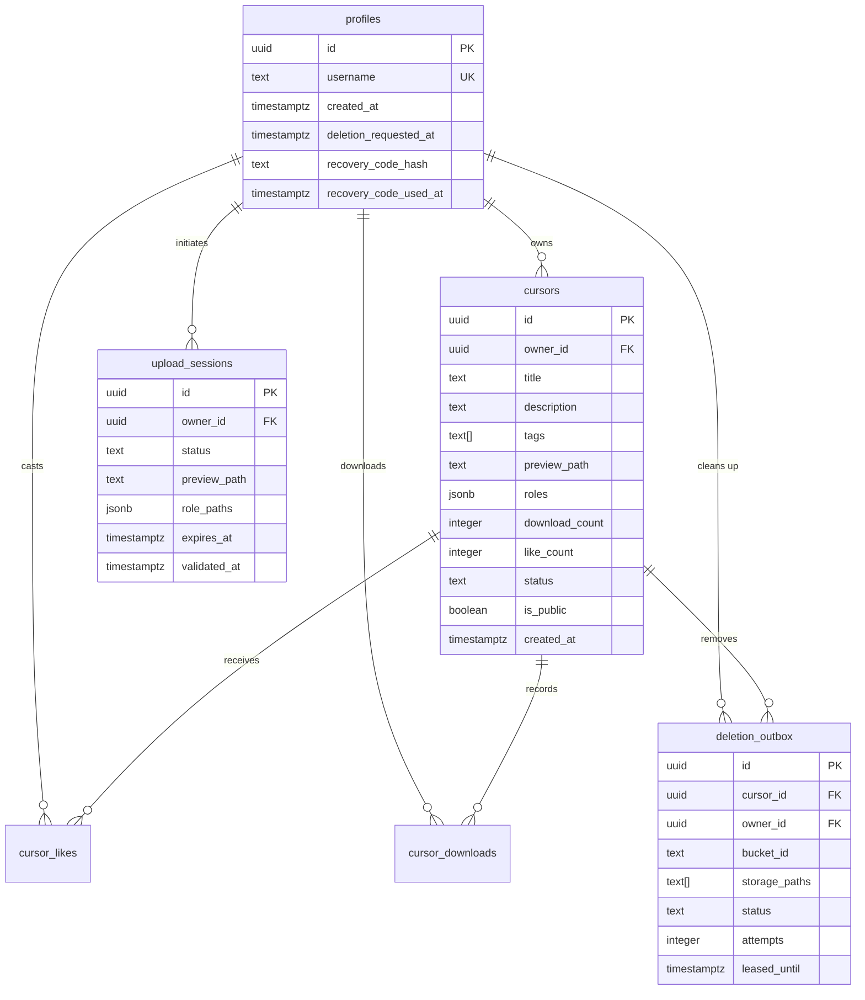

# Supabase Backend & Database Architecture

## 1. Overview

CursorForge uses a security-hardened **Supabase PostgreSQL 15+** backend for user authentication, cursor discovery, download tracking, community ratings, and asset storage. 

All database operations enforce least-privilege principles, strict Row Level Security (RLS), column-level `GRANT` / `REVOKE` restrictions, and atomic RPCs.

---

## 2. Entity-Relationship & Schema

---

## 3. Row-Level Security (RLS) Matrix

| Table | Operation | Role | Policy / Condition |
|---|---|---|---|
| `cursors` | `SELECT` | `anon`, `authenticated` | `status = 'approved' AND is_public = true` (or `owner_id = auth.uid()`) |
| `cursors` | `INSERT` | `authenticated` | **Denied** (Must use `complete_upload_session` RPC) |
| `cursors` | `UPDATE` | `authenticated` | `owner_id = auth.uid()` on allowed metadata columns only |
| `cursors` | `DELETE` | `authenticated` | **Denied** (Must use `request_cursor_deletion` RPC) |
| `cursor_likes` | `SELECT` | `authenticated` | `user_id = auth.uid()` |
| `cursor_likes` | `INSERT/DELETE` | `authenticated` | **Denied** (Must use `like_cursor` / `unlike_cursor` RPCs) |
| `upload_sessions`| `SELECT/UPDATE` | `authenticated` | `owner_id = auth.uid()` |
| `deletion_outbox`| `ALL` | `anon`, `authenticated` | **Denied** (Reserved for `service_role` and SECURITY DEFINER RPCs) |

---

## 4. Stored Procedures (RPCs)

### 4.1 `like_cursor(p_cursor_id uuid)`
- Enforces atomic insert into `cursor_likes`.
- On conflict, ignores duplicate like.
- Increments `cursors.like_count` atomically within the same transaction.
- Returns updated like count.

### 4.2 `unlike_cursor(p_cursor_id uuid)`
- Deletes user row from `cursor_likes`.
- If deleted, decrements `cursors.like_count` atomically (with a floor at 0).

### 4.3 `increment_download(p_cursor_id uuid)`
- Inserts into `cursor_downloads(user_id, cursor_id, download_date)`.
- Enforces `ON CONFLICT DO NOTHING` to prevent artificially inflating download counts within the same calendar day.
- If a new row was inserted, increments `cursors.download_count`.

### 4.4 `rate_limit_write(p_key text, p_limit int, p_window interval)`
- Transactional sliding-window rate limiter using Postgres `rate_limits` table.
- Atomically cleans expired buckets and calculates request density.

### 4.5 `lease_deletion_tasks(p_worker text, p_batch int)`
- Locks up to `p_batch` queued outbox tasks for 60 seconds (`leased_until = now() + interval '60 seconds'`).
- Prevents concurrent Edge Function workers from processing the same deletion.

---

## 5. Storage Buckets

1. **`cursor-previews`**:
   - Access: Public read (`SELECT` allowed for all).
   - Writes: Restricted to session owners for file paths matching `<owner_id>/<session_id>/preview.png`.
2. **`cursor-sources`**:
   - Access: Private (Only owner or `service_role` can download raw `.png` source art).
   - Uploads: Restricted to `<owner_id>/<session_id>/<role>.png`.

---

## 6. Deno Edge Functions

- **`validate-upload`**: Validates PNG signatures, dimension limits ($\le 128\times 128$), and byte sizes ($\le 100$ KB) before transitions to `validated`.
- **`process-deletion-outbox`**: Scheduled worker that leases outbox records and deletes raw storage objects in batches.
- **`reset-password`**: Single-use Crockford Base32 recovery handler that interacts with GoTrue Admin API.
- **`sweep-expired-sessions`**: Sweeps abandoned upload sessions and places their orphaned storage files into the deletion outbox.
- **`delete-account`**: Enqueues all user-owned cursor storage paths and purges the auth user record.
